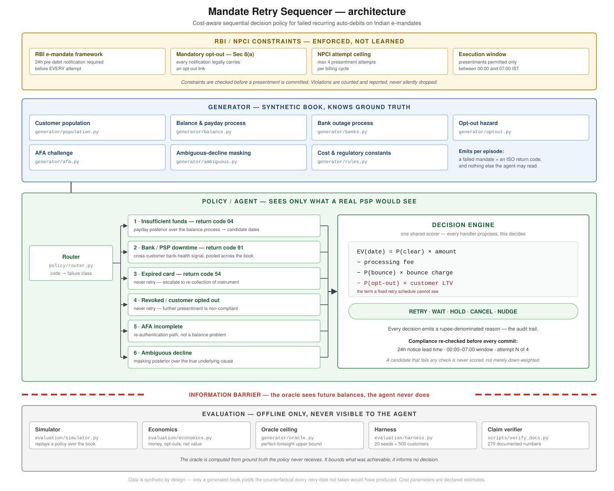

# Agentic AI Mandate Retry Sequencer

An agentic AI system that autonomously recovers failed recurring debits on Indian
e-mandates, within RBI and NPCI rules. **Status: in active development.**

Instead of firing a fixed day-2/4/7 schedule at every failure, an AI agent owns
each failed mandate end to end. It perceives the acquirer return code and the
customer's payment history, reasons about why the debit failed, plans by pricing
every legal retry date in rupees, and acts: RETRY, NUDGE, WAIT, HOLD or CANCEL.
Every decision is logged with its reasoning, so the agent's behaviour can be
audited step by step.

## Results

20 seeds x 500 synthetic customers, scored against a ground-truth oracle.

| | legacy fixed schedule | sequencer agent |
|---|---|---|
| money recovered | Rs 2,293,936 | **Rs 3,839,648** (+67.4%) |
| recovery rate | 36.2% | **59.4%** |
| pre-debit notifications | 4,091 | **1,633** |
| opt-outs induced | 146 | **45** |
| compliance breaches | 41 | **0** |

The agent captures about 70% of the headroom between the legacy schedule and the
oracle ceiling (69.0%). Rupees come from a generated book, not any merchant's
revenue; cost parameters are declared estimates.

## Agent architecture

1. **Perceive**: reads the return code and the customer's attempt history.
2. **Reason**: routes the failure to one of six classes and infers the hidden
   cause: payday timing, bank health, OTP completion, or a posterior over causes
   for ambiguous declines.
3. **Plan**: scores every candidate date as
   `P(clear) x amount - fees - P(bounce) x charge - P(opt-out) x LTV`
4. **Act**: takes the highest-value action under hard compliance guardrails
   (24h notice, 4-attempt cap, 00:00-07:00 window). Violations raise, never clamp.
5. **Explain**: records the runners-up, the arithmetic and the checks behind
   every decision.



## Findings

- The 24-hour notice rule structurally forecloses reacting to short outages;
  real-time bank-health monitoring changes zero rupees.
- The mandatory opt-out, not the timing rule, is the expensive part of the
  framework (~Rs 6,540 per 100 failures).
- Pricing churn with a book-average sensitivity is right on average and wrong for
  nearly half of customers.
- A nudge's real cost is the retry it unlocks, not the goodwill it spends.

Claims that didn't survive scrutiny were withdrawn or downgraded, and the full
write-up says so.

## In development

- Continuous perceive-reason-act loop over live decline streams
- LLM reasoning layer for free-text bank decline messages and merchant-facing explanations
- Tool-using agent workflow: notifications, nudges and escalation as callable tools
- Variance-aware churn pricing and a time-preference term for faster recovery

## Try it

```
pip install -e ".[dev]"
pytest                                   # 298 tests
python scripts/run_multiclass.py         # headline table
python scripts/show_audit.py --customer CUST_0013 --seed 42
python scripts/verify_docs.py            # every documented number reproduces
```

## More

Full write-up, ablations, per-class results: [docs/DETAILS.md](docs/DETAILS.md)
· Design notes and honesty items: [CONTEXT.md](CONTEXT.md)
